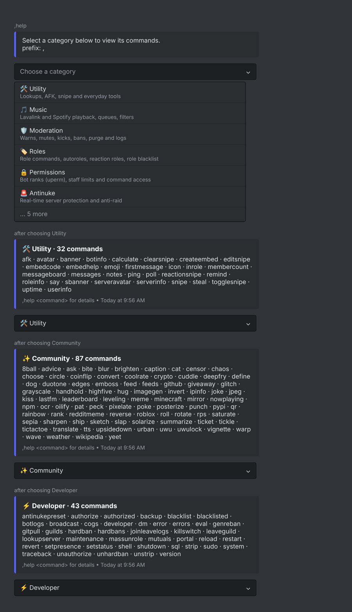
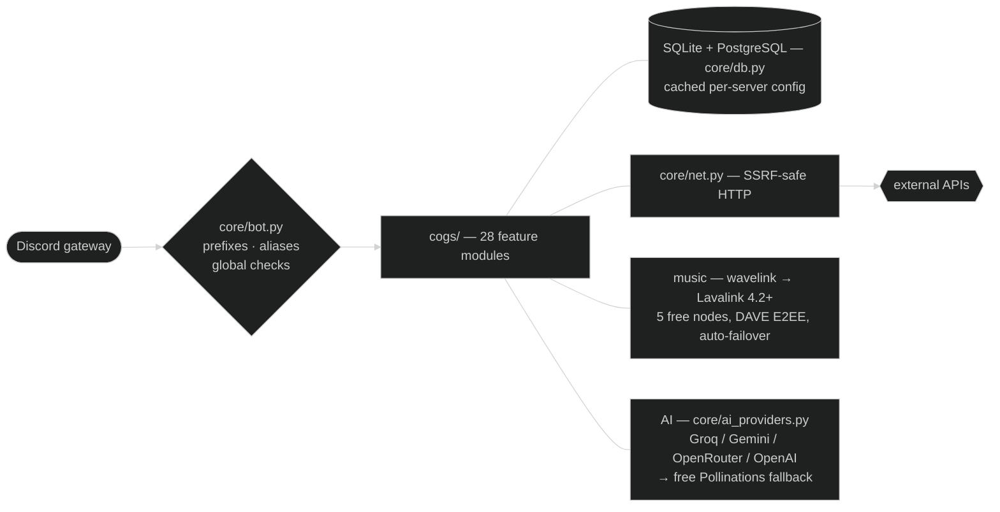

<div align="center">


<br/>

[](https://github.com/aidendixon602-png/veil-utilities/actions/workflows/check.yml)
[](https://python.org)
[](https://github.com/Rapptz/discord.py)


[](LICENSE)
[](https://github.com/astral-sh/ruff)


**Protection, moderation and community tools in one bot — built to replace the five you're running now.**

[Features](#-features) · [Quick start](#-quick-start) · [All commands](docs/COMMANDS.md) · [Hosting](docs/HOSTING.md) · [Contributing](.github/CONTRIBUTING.md) · [Changelog](CHANGELOG.md)

<details>
<summary><b>📑 Contents</b></summary>
<br/>

- [✦ Why veil](#-why-veil)
- [⚡ Features](#-features)
- [🚀 Quick start](#-quick-start)
- [🏗️ Architecture](#-architecture)
- [⚙️ Configuration](#-configuration)
- [👑 Developer tools](#-developer-tools)
- [🧪 Development](#-development)
- [🧱 Project structure](#-project-structure)
- [🗺️ Roadmap](#-roadmap)
- [🤝 Contributing](#-contributing)
- [📜 License](#-license)

</details>

</div>

<br/>

## ✦ Why veil

<table>
<tr>
<td width="33%" valign="top">

### 🛡️ Stops nukes cold
Audit-log antinuke with per-action thresholds. It punishes the attacker, then **puts the server back**: unbans their victims, rebuilds deleted channels and roles (with members and overwrites), and deletes whatever they created. `,an` shows every rule with buttons to turn it on, load a preset or change a rule. A join wave turns on raid mode, which pauses invites and DMs until it's quiet.

</td>
<td width="33%" valign="top">

### 🔐 You decide where it runs
The bot only works in servers a developer has **authorized**. It leaves anywhere else and sends you a one-click Authorize button.

</td>
<td width="33%" valign="top">

### 🎭 Fake permissions
Give mods `ban members` **only through the bot** — per role, or per member with named **permission levels** (`uperm add @user moderator`). Nobody on staff needs dangerous real Discord permissions.

</td>
</tr>
<tr>
<td valign="top">

### ✍️ Embed scripting
`{embed}$v{title: hi {user.mention}}` with 25+ variables, for welcome, boost, autoresponders, feeds and level-ups. `embedcode` turns any embed back into a script.

</td>
<td valign="top">

### 📡 Social feeds
New **YouTube** uploads, **Twitch** go-lives, **SoundCloud**, **Reddit**, Instagram, TikTok and X posts land in your channels with role pings.

</td>
<td valign="top">

### 👑 Real developer tools
Maintenance mode, a global kill switch, error IDs with tracebacks, log tailing and one-command database backups.

</td>
</tr>
</table>

## ⚡ Features

| | Module | Highlights |
|:-:|---|---|
| 🛡️ | **Antinuke** | 14 attack types (mass ban/kick/timeout/unban, channel & role deletes, webhooks, bot adds, vanity changes, dangerous permission grants on roles, members and channel overwrites…), sliding-window thresholds, undoes everything the attacker did in the last 10 minutes, ban / kick / strip, a button panel (`,an`), raid mode that pauses invites and DMs, global alerts to developers. Also watches actions done **through the bot's own commands**, so fake permissions can't be used to nuke |
| 🚨 | **Antiraid** | Mass-join raid mode, minimum account age, no-avatar filter, per-user bypass |
| 🔨 | **Moderation** | Numbered cases + mod-log, DM notices, warn escalation, hardban, jail with role restore, force-nickname, `massban`, 10 purge filters, lockdown, nuke, mass role tools |
| 🧹 | **Automod** | Invites, links (with allowlist), spam, caps, mentions, emojis, zalgo, words, regex → delete or timeout |
| 🎙️ | **VoiceMaster** | Join-to-create channels with a button panel: lock, hide, rename, limit, claim, transfer. Remembers each user's settings |
| 🔑 | **Permissions** | Named levels for members and roles: Helper → Moderator → Admin → Head Admin → Bot Manager → Overseer → Supreme Leader, plus automatic Owner & Developer, role blacklist, `removepermall` to strip a permission from every role after a raid |
| 🧩 | **Server** | Welcome / goodbye / boost, autoroles, reaction & button roles, autoresponders, sticky messages, starboard, counters, bump reminders, vanity rewards |
| 📈 | **Levels** | Message **and** voice XP, role rewards, XP multipliers, leaderboard |
| 🎉 | **Community** | Giveaways with requirements, tickets with transcripts |
| 🤖 | **AI** | `ask` (chat with memory), `summarize`, `imagine` (free image generation), `tts`, `ocr` |
| 🖼️ | **Images** | 29 effects (deepfry, caption, meme, glitch, sketch, duotone, pixelate, warp, chaos…). GIFs stay animated |
| 🎵 | **Music** | Lavalink player, queue, loop, seek, autoplay, nightcore / bassboost / 8D presets, optional DJ role with vote-skip, auto-leaves empty channels |
| 🌐 | **Lookups** | Last.fm (np, whoknows, top charts), weather, GitHub, crypto, Roblox, Minecraft, translate, Wikipedia, Urban Dictionary |
| 🛠️ | **Utility** | Snipe / editsnipe, AFK, reminders, user & server info, emoji steal, message stats, polls, custom aliases, self prefix |
| 🎲 | **Fun** | Tic-tac-toe, ship, 8ball, 16 anime interactions, uwulock |

<details>
<summary><b>Help menu preview</b></summary>
<br/>

<div align="center">

</div>

A plain home card with one button per category you're allowed to open. Each category is a single page: every command with its arguments and what it does (`,play <query>` - play a song or playlist.), then its aliases, and a ← Back button. `,help <command>` gives a card with syntax, an example, aliases and the rank or permissions it needs, and a typo suggests close matches. The menu is owner-locked: only the person who ran `,help` can use it, and the **Developer** category only appears for developers. Every bot response also replies to your message (without pinging).
The menu and [the command reference](docs/COMMANDS.md) are both built from the live command list, so they can never disagree.

</details>


## 🚀 Quick start

```bash
git clone https://github.com/aidendixon602-png/veil-utilities
cd veil-utilities
pip install -r requirements.txt
cp .env.example .env          # add your DISCORD_TOKEN, that's all it needs
python main.py
```

1. In the [Discord developer portal](https://discord.com/developers/applications), turn on **all three Privileged Gateway Intents**.
2. Invite the bot with Administrator, then **drag its role to the top** so antinuke can act on anyone.
3. Try it out:

```
,antinuke enable            ,antiraid massjoin 10 10
,logs setup                 ,modlog #mod-logs
,vm setup                   ,leveling on
,fp grant @Mods ban_members, kick_members, moderate_members
```

> **Hosting on Wispbyte or another Pterodactyl panel?** Follow the [hosting guide](docs/HOSTING.md). It covers the 512 MB free plan, GitHub auto-deploy and troubleshooting.

## 🏗️ Architecture



One cog per feature, behind typed, validated config ([`core/config.py`](core/config.py)) and a single safe-HTTP
helper. Everything optional degrades instead of crashing: no Lavalink node hides music, no AI key falls back
to the free provider, and a failed background loop takes down nothing else.


## ⚙️ Configuration

Everything lives in `.env` (copy `.env.example`). Only the first two are required. All settings are typed and validated in [`core/config.py`](core/config.py) — if a value is missing or malformed, the bot refuses to start and lists every problem at once.

| Variable | Purpose |
|---|---|
| `DISCORD_TOKEN` | Your bot token. **Never commit it.** |
| `OWNER_IDS` | Optional. Developers are found automatically (the owner or team of your bot's Discord application); list IDs here only to add more. Developers unlock the Developer commands and server authorization |
| `AUTH_REQUIRED` | `true` = only authorized servers can use the bot |
| `PRIVATE_MODE` | `true` (default) = only developers, server owners and people with a permission level can run commands; everyone else and DMs are ignored silently. `false` opens public commands to every member |
| `LOW_MEMORY` | `true` on small hosts: smaller caches and image limits |
| `ERROR_LOG_CHANNEL` | Optional. The bot makes a private `#veil-errors` channel for crash tracebacks (and `#veil-auth` for server alerts) by itself; set an ID only to use your own channel |
| `ANTINUKE_DEV_ALERTS` | DM developers a "Global antinuke alert" whenever antinuke fires |
| `TEST_GUILD_ID` | Optional. Pins the test server for `,testnuke`; normally it's picked in Discord (`,testserver set`, or the first confirmed `,testnuke`) |

**Integrations: all optional.** Everything below works out of the box. Keys only make things faster or unlock extras.

| Variable | Without it | With it |
|---|---|---|
| `AI_API_KEY` | Free no-signup AI (slower) | Paste a Groq (`gsk_`), Gemini (`AIza`), OpenRouter (`sk-or-`) or OpenAI (`sk-`) key and the provider + model are picked automatically. Falls back to the free AI if your quota runs out. `AI_BASE_URL` / `AI_MODEL` override (e.g. local Ollama) |
| `LAVALINK_URI` / `_PASSWORD` | Free public Lavalink nodes with automatic failover | Your own Lavalink 4.2+ server(s), comma-separated. `MUSIC_ENABLED=false` turns music off |
| `OCR_SPACE_API_KEY` | Shared demo key (rate-limited) | Free personal key from ocr.space |
| `LASTFM_API_KEY` | Last.fm commands are off | Free key from last.fm/api/account/create |
| `SPOTIFY_CLIENT_ID` / `_SECRET` | `,sp` search uses Deezer data + Spotify links | Real Spotify data (Spotify requires the app owner to have Premium) |
| `TWITCH_CLIENT_ID` / `_SECRET` | Twitch feeds are off (YouTube, Reddit, SoundCloud, RSS still work) | Twitch live alerts |
| `RSSHUB_URL` | Public RSSHub for Instagram/TikTok/X feeds (often blocked) | Your own RSSHub instance |

## 👑 Developer tools

Hidden from everyone else and listed under **Developer** in the help menu (or `,dev` / `,secret`):

| Command | What it does |
|---|---|
| `developer` · `dev` · `secret` | Opens help on the Developer category: every developer command, same layout as the rest of help |
| `testnuke [roles] [channels]` · `testcleanup` | Fake nuke in the test server (picked in Discord with `testserver set` or the first confirmed test) to check the antinuke catches and undoes it; asks for confirmation first, nobody is punished. `testcleanup` removes anything left. Only for IDs in `OWNER_IDS` |
| `eval` · `sql` · `sudo` · `shell` | **NEW**: Python evaluation, raw SQL queries, sudo impersonation, and container bash shell execution |
| `portal` · `broadcast` | **NEW**: Instant server invite link creator and global alert broadcast |
| `system` | Live system health: uptime, shard latency, memory, CPU, database size, error sequence |
| `cogs` · `traceback` | **NEW**: List all 28 loaded cogs and inspect the latest crash traceback |
| `maintenance on [reason]` | Toggle global maintenance mode with alert timer |
| `killswitch <command>` | Disable a broken or abused command everywhere, instantly |
| `errors` · `error [id]` | Recent crashes and full tracebacks (defaults to latest error) |
| `botlogs` · `backup` | Tail live container logs · DM yourself a full database backup |
| `strip` · `unstrip` · `massunrole` · `revert` | Emergency role stripper, restore tools, and raid rollbacks |
| `hardban` · `unhardban` · `hardbans` | Network-wide bans across every server the bot is in |
| `authorize` · `unauthorize` · `authorized` | Whitelist management (devs automatically authorized for everything including BLED) |
| `lookupserver` · `mutuals` · `guilds` | Deep inspection of servers and mutual member intelligence |
| `blacklist` · `dm` · `reload` · `restart` · `gitpull` | Blacklist management, developer DM, hot-reloading, and GitHub sync |

## 🧪 Development

```bash
pip install -r requirements-dev.txt
ruff check .          # lint
python -m pytest -q   # unit tests + offline smoke test (loads every module)
python scripts/gen_commands.py   # regenerate docs/COMMANDS.md after adding/changing commands
```

Version lives in [`pyproject.toml`](pyproject.toml). CI — lint, the full test suite, the smoke test that loads every module, and `.env.example` validation — runs on every push, on Python 3.11 and 3.12.
A test fails if `docs/COMMANDS.md` doesn't match the real commands, so the reference never goes stale.

## 🧱 Project structure
```
veil-utilities/
├── main.py                  entry point: checks the environment, pulls updates, starts the bot
├── core/                    the engine
│   ├── bot.py               prefixes, aliases, global checks, error handling, cog loading
│   ├── config.py            typed, validated settings loaded from .env
│   ├── db.py                SQLite + PostgreSQL backend with per-server JSON config
│   ├── help.py              the ,help menu: category buttons, pages, command cards
│   ├── logembeds.py         every log card, in one place
│   ├── perms.py             named permission levels & staff hierarchy
│   └── …                    dashboard, modlog, antinuke restore, redaction, git updates, utils
├── cogs/                    one file per feature module
├── tests/                   pytest suite; runs on every push
├── scripts/                 gen_commands.py (keeps docs/COMMANDS.md and the badges in sync)
├── docs/
│   ├── COMMANDS.md          auto-generated reference of every command
│   ├── HOSTING.md           free hosting walkthrough (Wispbyte and other Pterodactyl panels)
│   └── lavalink/            optional self-hosted music server config
├── assets/                  banner, previews, bundled caption font
├── .github/                 CI, contributing guide, security policy, code of conduct, templates
├── .env.example             every setting, documented
├── pyproject.toml · requirements.txt · requirements-dev.txt
└── CHANGELOG.md · LICENSE · README.md
```


## 🗺️ Roadmap

- [x] Full bug audit + zero-setup integrations (every optional API has a free fallback)
- [x] Auto-generated command reference that CI refuses to let go stale
- [x] Web dashboard for per-server configuration
- [x] PostgreSQL backend option for large deployments
- [x] Audit pass over automod · logging · permissions cogs
- [x] Developer lockdown: hidden commands are invisible to non-developers
- [x] Developer commands in the same help menu (developers only)
- [x] Automatic developer authorization & BLED bypass
- [ ] More image filters and AI models

Have an idea? [Open a feature request](https://github.com/aidendixon602-png/veil-utilities/issues/new?template=feature_request.md).

## 🤝 Contributing

Pull requests are welcome — [CONTRIBUTING.md](.github/CONTRIBUTING.md) covers the setup, the coding style and
the three commands to run before pushing (`ruff`, the tests, and `gen_commands.py`).
Found a security problem? Please follow [SECURITY.md](.github/SECURITY.md) instead of opening an issue.

## 📜 License

[MIT](LICENSE) — do whatever you want, just keep the notice.

<br/>

<div align="center">
<sub>Built with discord.py · Made by <a href="https://github.com/aidendixon602-png">@aidendixon602-png</a></sub>
</div>
